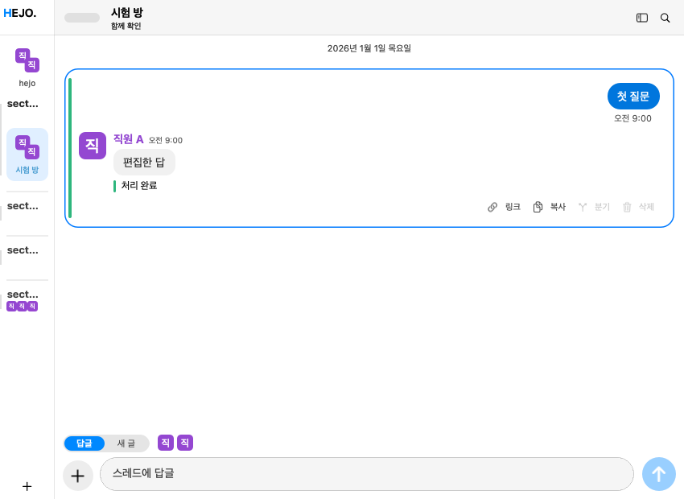
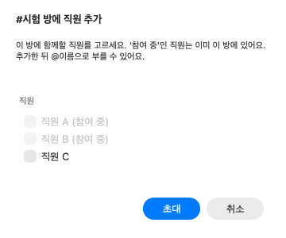

# TASK-21 단체방

필요·도달 증거 수준은 2다. 가짜 명부 세 직원, 방 안 두 직원, 같은 방 이름·설명·참여 상태로 비교했다. 실제 서버·두 Mac·운영 앱 전체 관측은 TASK-23에 남는다.

위 그림은 제품 ConversationView·카드·사이드바·작성기를 실제 AppKit 창에 조립한 것이다. 기록장 입력과 직원 사진·색은 가짜 자료다.

| 원본 ddots 직원 추가 | hejo 직원 추가 |
| --- | --- |
|  |  |

초대 비교는 원본 SlackRoomDialogs.swift 전체를 분리 컴파일한 실제 inviteDialog와 제품 RoomDialogs의 실제 dialog가 만든 문구·NSButtonCell·참여 중 비활성 상태를 같은 320px 내용 폭·22px 행의 AppKit 시험 창에 그렸다. 용어는 변환 규칙 1번(직원·방)을 적용했다. NSAlert 창 자체 캡처는 이 환경에서 글·체크박스가 빠져 비교 근거에서 제외했다. 위 두 그림은 창 내용 분리 시험이며 운영 창 전체 또는 NSAlert 외곽의 픽셀 일치를 주장하지 않는다. 이미지의 글·위치·색을 사후 수정하지 않았다.

자동 시험은 AC-03 메뉴 순서·참여 직원 흐림·대표 체크·@ 후보·방/발화자 분리·보관과 복원·방 삭제와 같은 seq의 캐시 치환을 확인한다. 실제 루프백 문 + AppKit 앱 + 가짜 Hermes는 일반 방과 고정 채널 홈의 13개 직원 전달, 대표·얼굴·본문 호출·별명·방 밖 직원·다중 호출·빈 본문을 관측한다. 문 고장 주입은 room_delete 쓰기 실패·확정 뒤 정리 실패/재시작·늦은 답/편집/상태/작성 중/파일·옛 연결·사진 인증/존재/갱신 실패를 확인한다.

재현 도우미와 전체 로그는 추적하지 않는 `.build/task21/`의 `dialog_compare.py`·`dialog-comparison.json`, `white_capture.py`·`capture-final.json`, `frozen-foundation.log`·`frozen-app-results.json`, `mutations.json`에 있다. 롤백은 design 15판대로 이전 공용 릴리스와 운영 적용 전 shared/hejo 사본을 함께 복원한다(TASK-23에서 수행).
