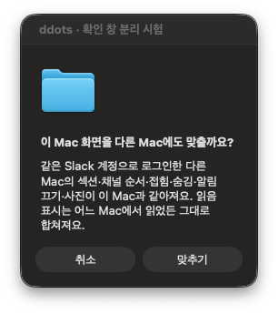
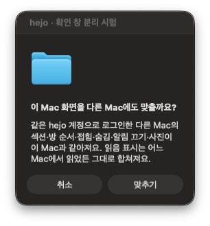

# TASK-24 회원 상태와 화면 배치 동기화

인계 증거 수준 2의 자동 시험 자료다. 운영 회원이나 실제 두 Mac을 사용한 수락 증거는 아니며, 그 확인은 TASK-23에 남는다. 관련 계약은 REQ-HF-26과 AT-HF-73·74이고 명령·결과는 impl-report의 TASK-24 절과 로컬 `.build/task24-*` 로그를 따른다.

## 확인 창 비교

같은 상태(연결됨, 배치를 이 Mac 기준으로 맞추기 직전, 비활성 시험 창)에서 비교한다. ddots는 원본 `208f6e6322f593729c9ef6ac16ac903be4c3692b`의 `App.makeSyncStandard` 확인 창 생성문을 그대로 분리 실행했다. hejo는 실제 `PetSettingsWindow.layoutConfirmation`을 앱 시험 실행 파일에서 호출했다. ddots 서비스·로그인·운영 자료는 실행하거나 읽지 않았다.

macOS에서 NSAlert 창의 직접 캡처가 빈 영상으로 나와, 각 NSAlert의 실제 AppKit contentView를 일반 시험 창에 담아 창 단위로 캡처했다. 제목줄의 '분리 시험'과 기본 아이콘은 시험 환경 표시다. 운영 앱 전체나 실물 연결을 캡처한 것으로 해석하지 않는다.

| ddots 원본 확인 창 | hejo 확인 창 |
|---|---|
|  |  |

제목·설명 구조·맞추기/취소 버튼은 같고, 승인된 19판에 따라 Slack을 hejo로, 채널을 방으로 바꿨다. 긴 설명은 AppKit의 기본 줄바꿈을 사용한다. 문구의 정확한 일치는 앱 자동 시험에서도 단언한다.

## hejo 설정과 미연결 안내

- [연결과 동기화 탭](task24-hejo-sync-settings.png): AppKit 탭과 '화면 배치 동기화…' 버튼.
- [미연결 안내](task24-hejo-offline.png): '아직 맞출 수 없어요'와 'hejo에 연결된 뒤 다시 해 주세요.'

자동 시험은 회원별 LWW/읽음 큰 값/잘라내기, 동시 PATCH와 파일 쓰기 실패, 처음 옮기기의 단일 저장·즉시 종료 후 재실행, 오프라인 대기열·재연결·전송 중 추가 변경, 30초 타이머 콜백·활성화, 방 읽음 위치와 스레드 정리, 명시적 배치 덮어쓰기와 읽음 불변을 확인한다. 실제 두 Mac·운영 재시작·운영 회원 이전은 미실행이다.
