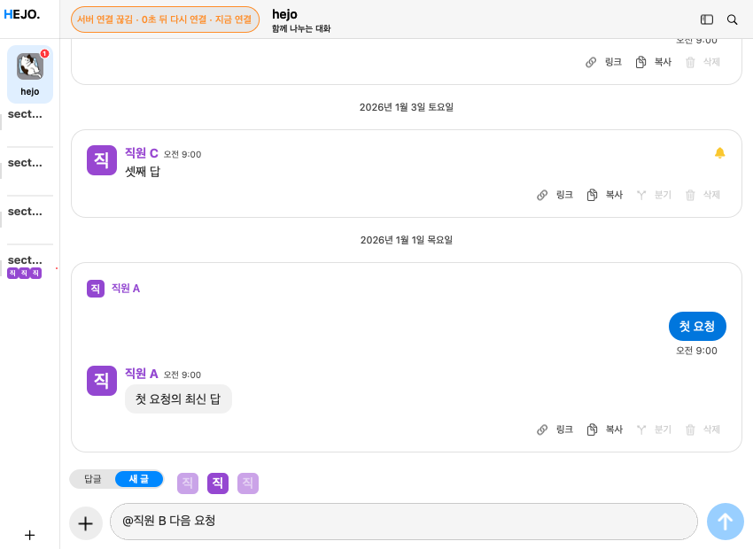

# TASK-27 홈 방

필요·도달 증거 수준은 2다. 직원 A/B/C의 1:1 기록을 섞은 가짜 상태로 실제 AppKit 대화 보기를 조립했다. 최근 답이 있는 스레드를 아래에 두는 원본 활동 순서를 유지한다. 홈의 기록 사본이나 가상 방은 만들지 않는다.

같은 직원·24px 얼굴·색·직원 B 대상 상태의 원본과 hejo를 비교했다.

| 상태 | 원본 ddotsFaces | hejo ComposerFaces |
| --- | --- | --- |
| @직원 B 입력, 링 없음 |  |  |
| 직원 B 얼굴 선택, 링 있음 |  |  |

원본은 SlackPanel.ddotsFaces·ChatPanel.face/avatarBadge·ProfileAvatar 그리기를 분리 컴파일했고, SlackThreads.Ddots.byActivity도 원문 그대로 실행해 순서를 확인했다. 명부·색·선택 상태는 가짜 자료이며 외부 동작과 개인 아바타 읽기는 대역이다. 원본 앱·Slack 전체를 실행하지 않았다. hejo 전체 그림은 제품 ConversationView 조립 시험이며 선택 링 그림은 같은 제품 ComposerFaces를 분리 조립했다. 얼굴 줄의 투명 PNG는 실제 시험 창과 같은 흰 배경에 합성해 비교했다. 글·위치·모양은 바꾸지 않았다.

루프백 가짜 문은 얼굴 > @ > 기본, 새 UUID, 원래 스레드 답글, 다중/제외 호출 무송신을 실제 WebSocket 프레임으로 확인한다. 사진은 기존 인증 경로의 PUT·실패 DELETE·성공 DELETE를 관측하며, 실패 때 회원 상태의 기존 주소가 유지된다. 읽음 키 공유·홈 알림 끔·직원 포함/제외·회원 상태 복원과 메뉴 체크는 AppKit 시험에 있다.

재현 도우미·로그는 추적하지 않는 `.build/task27/`의 `reference.py`, `reference.json`, `reference.log`, `faces_capture.swift`, `capture_final.py`, `capture-final.json`, `network.py`, `network.log`다. 실제 서버·두 Mac·운영 앱 전체 확인은 TASK-23에 남는다.
