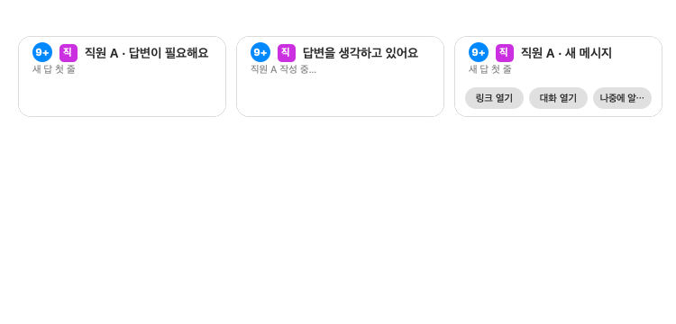
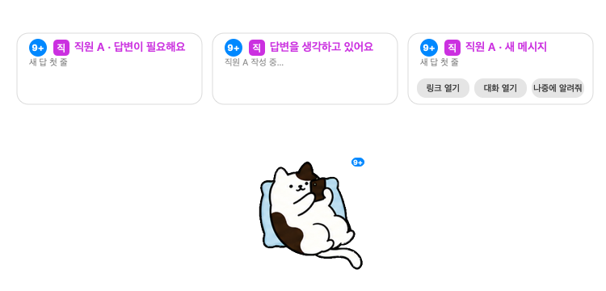

# TASK-29 펫 알림 화면 근거

보완 28 / REQ-HF-30 / AT-HF-81. 가짜 직원 A, 질문·작성 중·새 답, 안 읽음 12, 웹 링크가 있는 같은 상태를 원본 BubbleTextView와 hejo FoldedBubbleView에 넣었다.

| 원본 AppKit 그리기 | hejo AppKit 그리기·접힌 펫 |
| --- | --- |
|  |  |

원본은 PetView.swift의 BubbleTextView 전체·PetLayout.swift actionRects를 분리 컴파일했다. 외부 계정·콜백·답하기·얼굴 데이터는 불활성 가짜 대역이다. 원본 앱이나 운영 앱 전체를 실행한 비교가 아니다. 직원 얼굴·이름 색은 TASK-20의 hejo 원본을 사용하며 버튼은 AppKit 제어로 바뀐다. 말풍선 폭 231·버튼 있을 때 높이 90, 글자 14/11, 배지 9+, 버튼 순서와 줄 구성을 대조했다. 원본의 마지막 버튼은 폭에 따라 줄임표로 보일 수 있다. 접근성 이름은 전체 문구다.

하단은 실제 PetView/atlas 조립에서 숨겨진 말풍선 대신 머리 옆 9+ 배지가 보이는 상태다. 생각 풍선은 원본처럼 말풍선이 보일 때만 그리며 7/11/16pt·간격 조건을 자동 시험했다(26판 원문 우선). 원본 앱의 다른 기능·운영 상태 비교와 실제 답 도착은 TASK-23에 남는다. 동작 줄이기·12초/30분 경계·실제 버튼 전달·한 번 뛰기는 AT-81 자동 시험으로 확인한다.

실행 자료는 추적하지 않는 `.build/task29/`의 `focused-check.json`, `capture-final.log`, `reference.json`에 있다. 캡처·자동 시험 증거 수준은 2다.
