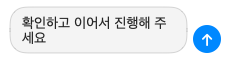
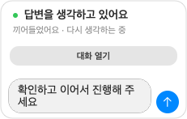

# TASK-30 말풍선에서 바로 답하기

필요·도달 증거 수준은 2다. 가짜 직원 A, 작성 중 스레드, 입력 ‘확인하고 이어서 진행해 주세요’를 같은 너비 231pt·밝은 화면으로 비교했다. 원본 앱·운영 앱 전체 실행과 실제 서버 답 도착은 이 자료의 범위가 아니며 TASK-23 실물 확인에 남는다.

| 원본 입력 줄 | hejo AppKit 입력 줄 |
| --- | --- |
|  |  |

원본은 ddots BubbleReply.swift·BubbleReplyCard.swift·DraftEditor.swift 전체를 바꾸지 않고 분리 컴파일했다. 실제 원본 BubbleReplyView·NativeDraft를 사용했고, 서식·붙여넣기 변환·테마 알림 의존은 이 평문 상태에서 쓰이지 않는 대역이다. 원본 앱 자체와 Slack을 실행하지 않았다. hejo는 제품 PetController·PetView·BubbleReplyCard를 조립한 시험 창에서 그렸다.

이 상태의 입력 줄 캡처 높이는 원본 60px·hejo 57px로 3px 차이가 있다. SwiftUI 호스트와 AppKit 평문 편집기의 글줄 측정 차이를 포함하며 화소 완전 일치 증거로 보지 않는다. 입력 2줄, 보내기 28px, capsule 16px·안쪽 12/7pt·바깥 10/7pt, 같은 문구·줄바꿈을 대조했다. 원본은 SwiftUI 외곽에 AppKit 편집기를 넣지만 제품은 AppKit만 쓴다. 3줄보다 긴 글은 원본처럼 삭제하지 않고 스크롤한다(26판). 스레드별 초안 복원은 hejo의 승인 계약을 따라 기존 대화 초안 칸을 재사용한다.

재현 도우미와 로그는 추적하지 않는 `.build/task30/reference.py`, `reference.json`, `focused_check.py`, `capture-final.log`에 있다. 자동 수락 시험은 `app/Tests/BubbleReplyTests.swift`, `bubble_reply_fixture.py`, `tests/acceptance/test_bubble_reply.py`다. 늦은 거절은 실제 루프백 WebSocket을 통과하며 외부 서버·실제 계정·비밀 파일을 사용하지 않는다.
