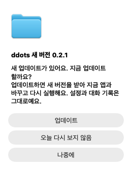
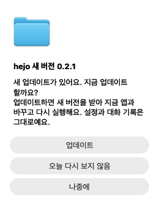
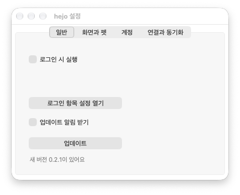

# TASK-33 화면 근거

- 가짜 최신 버전 0.2.1, 현재 0.2.0/빌드 2, 공개 저장소 예제로 비교했다. 원본 `automaticAlert` 전체 함수와 hejo의 같은 실제 함수를 각각 분리 컴파일했다. 운영 앱 전체 비교가 아니며 인계 증거 수준 2의 조립 근거다.
- 알림 창의 반투명 재질은 이 환경의 PNG에서 글과 배경이 사라졌다. 그 초기 파일은 증거에서 제외했다. 두 함수의 문구·버튼·기본 레이아웃은 그대로 두고, 캡처 하네스의 contentView에 같은 흰 불투명 배경을 줘 그렸다. 폴더 아이콘은 분리 실행 번들의 기본 아이콘이며 제품 아이콘 비교 대상이 아니다.
- ddots → hejo만 22판 문구 변환 규칙 1번이다. 제목, 두 문장의 순서, 버튼 세 개와 Esc는 나머지 원문을 유지한다.
- hejo 설정은 실제 PetSettingsWindow를 가짜 릴리스 상태에 연결한 시험 창 캡처다. 최신 버전 표시와 직접 업데이트 버튼을 보여 준다. 이 그림은 원본 설정 창 전체의 픽셀 일치를 주장하지 않는다.
- 설치된 두 Mac에서 실제 내려받기·교체·재실행과 디스크 실패는 TASK-23 실물 확인에 남는다. 이번에는 앱 사본이나 공용 릴리스를 바꾸지 않았다.

| ddots 원본 함수 | hejo 실제 함수 |
| --- | --- |
|  |  |

