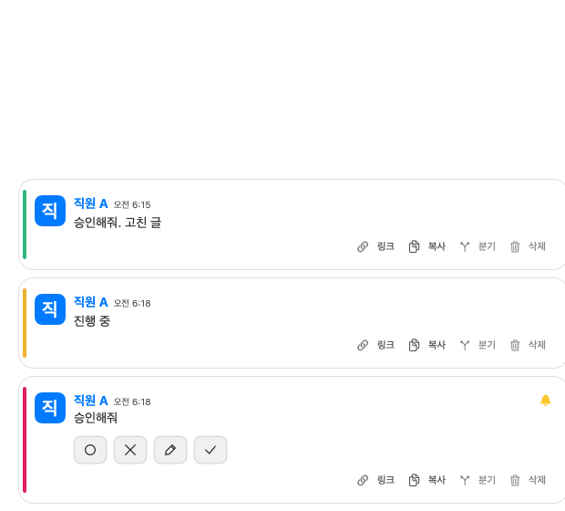
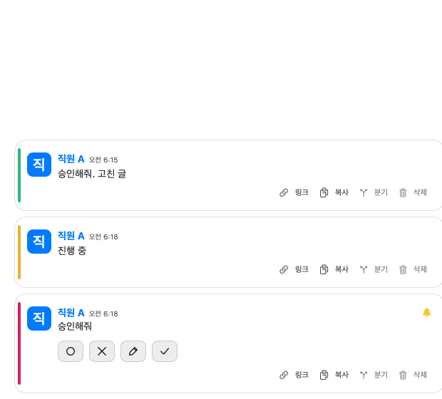

# TASK-36 읽음·종·버튼 규칙 비교

## 범위

대조표 2판 §A·V01·V02·V16과 §0-4 2.1판 A13~16, 보완 50의 `answer_to`를 확인한다. 운영 자료 대신 가짜 명부·같은 시각·같은 본문을 쓴다. 실제 서버·운영 앱 전체 비교는 아니며 인계 증거 수준은 2다.

## 같은 상태 화면

| ddots 원본 조각 | hejo 제품 보기 조립 |
|---|---|
|  |  |

- N36-02(보완 51): TASK-37에서 가짜 루프백에 실제 연결하고 `canSend == true`를 확인한 최종 빌드로 hejo PNG를 다시 찍었다.
- 아래부터 승인 요청(빨강 `#E01E5A`·종·기본 네 단추), 처리 중(노랑 `#ECB22E`·종 없음), 종결(초록 `#2EB67D`·종 없음)이다. 생성된 “처리 완료” 글자 줄이 없다. 본문에 사장이 쓴 글은 지우지 않는다.
- 원본은 `NativeThreadCard.swift`·`ReplyActionIcon.swift`·`ConversationRules`와 `SlackPanel.slackApproval`을 분리 실행한다. 원본 바깥 controls의 왼쪽 43pt·위 2pt를 포함한다. 네트워크 callback·측정 hook은 대역이고, 체크리스트 경로는 이 화면에서 쓰지 않는다. 공통 표시 조건은 글씨 14pt·가짜 직원 색 파랑·밝은 화면이다.
- hejo는 실제 `ConversationView`가 만든 Content를 실제 AppKit 카드로 조립한다. 임시 저장소와 연결 완료 대역을 쓰며, 사진·운영 설정은 읽지 않는다. AppKit 답 단추의 경로·16pt 기호·36×30 영역·간격 8·모서리 8은 원본 기하를 옮겼다. 원본은 SwiftUI 호스팅이고 제품은 AppKit이다. 화면 전체의 픽셀 동일성을 주장하지 않는다.
- 캡처 준비 중 AppKit 버튼의 flipped 좌표 때문에 확인 기호가 뒤집힌 것을 발견해 고쳤다. 최종 파일은 최종 제품 빌드에서 다시 생성했으며, 620×560 PNG 유효성·세 상태 막대·실제 표시를 확인했다. 화면 밖의 빈 여백과 기본 글꼴 래스터 차이는 기능 판정으로 쓰지 않는다.

## 규칙·통신 비교

- 원본 `answers`·`pendingPosts` 그대로 분리 실행: A가 처리 중, B가 질문이고 사장 글이 “승인”일 때 A 대상 답이면 B 대기, 직접 쓴 글이면 대기 없음이다.
- 새 문·새 앱의 실제 루프백: 버튼 답에만 `answer_to`, 새 기록장 복구·빈 캐시 재접속에서 같은 구분, 직접 쓴 동일 낱말로 B가 답해짐을 확인한다. 앱의 send에 `answer_to`를 넣는 위조는 거절한다.
- 옛 문 `aeaa652`·새 앱은 선택 필드가 없으므로 직접 쓴 글처럼 해석한다. 이것은 35판에 승인된 알려진 차이다. 옛 앱 소스의 GateClient·LocalStore·ConversationModel도 새 필드가 있는 실제 기록을 읽는다.
- 읽음·본문 승인·질문 순서·별명·본문 revision별 체크·내 글 색은 AT-87 앱 시험으로 확인한다. 실물 입력과 두 Mac 운영 결합은 이후 운영 수락에서 확인한다.

전체 로그·명령 결과는 추적하지 않는 `.build/task36/`에 두고 최종 인계 보고에서 해당 파일을 지정한다. 원본 앱 실행·ddots 파일 수정·앱 사이 동기화는 하지 않는다.
