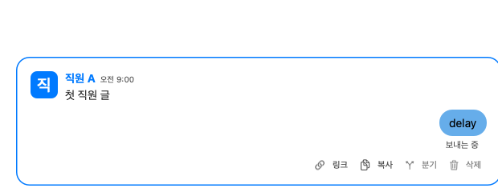
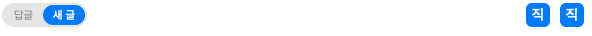

# TASK-37 작성기·전송·초안 비교

대조표 2판 §B와 §0-4 2.1판 B15~18, 보완 51을 확인한다. 가짜 명부·밝은 화면·14pt·파란 얼굴과 같은 본문을 쓰며 hejo는 실제 루프백 연결 완료 상태다. 필요한/도달 인계 증거 수준은 2/2다.

| 장면 | ddots 원본 조각 | hejo 제품 보기 조립 |
|---|---|---|
| 답글 전송 확인 전 |  |  |
| 빈 단체방 작성기 줄 |  |  |

- 전송 대기 장면은 같은 직원 첫 글에 사장 글 `delay`를 보낸 직후다. 확인 전 글의 0.6 흐림, 시간 자리 “보내는 중”, 실제 연결에서 누를 수 있는 스레드 제어를 비교한다. hejo의 글은 pending 메모리에서만 보이고 기록장 캐시에는 쓰지 않는다.
- 작성기 줄은 빈 단체방의 새 글 모드다. 모드 캡슐·선택됨 접근성·다시 누름 금지, 얼굴 24pt·각 4pt 여백·단추 사이 2pt·각각의 멘션 접근성/툴팁을 확인한다. 제품 줄의 투명 부분은 같은 흰 캔버스 위에 source-over로 내보냈다. 내용·기하를 다시 그리거나 보정하지 않았다.
- 원본은 `NativeThreadCard`와 `SlackPanel.slackModeButton`·`mentionFaces`를 분리 실행한다. 동일한 14pt 글꼴/얼굴 렌더링 도우미, 가짜 callback과 roster를 쓴다. hejo는 실제 `ConversationView`의 Content·작성기 제어다. 운영 앱 전체 실행·픽셀 동일 비교가 아니다.
- 관측 차이: SwiftUI 원본의 비활성 선택 캡슐은 시스템이 더 옅게 그린다. AppKit 제품은 선택 accent를 유지하고 비활성 동작/접근성을 적용한다. 멘션 줄의 끝 여백에도 2pt 차이가 있다. 글꼴 래스터·이 차이를 픽셀 동일 통과로 주장하지 않는다.

초안 auto/new/thread 자리, 최근 활동 대상, 열린 작업 스레드로 끼어들기, queue 직원의 표시 생략, 답들 뒤·작업 줄 앞의 왼쪽 끼어들기 표시는 실제 AppKit 시험으로 확인한다. 루프백에서는 늦은 확인/거절·연결 복구·새 글/홈 글의 실패를 시험하며, 이후 입력과 파일·받을 직원을 보존한다. 새 글에 고정 초안 UUID를 전송하도록 바꾼 돌연변이는 검출됐다.

N36-01의 날짜 분기는 제거했다. 날짜와 무관하게 `allowed`에 들어 있던 옛 범례 본문은 결과 불변 지시대로 유지했다. 원본/제품 분리 실행 근거는 `.build/task37/policy-comparison.json`이다. B05의 중단 표시는 별도 Hermes 기록 보기에서만 생산되고 Slack 방 경로는 기본 false임을 확인해 새 이벤트를 추정하지 않았다.

N36-02는 [TASK-36 화면](TASK-36.md)의 hejo PNG를 실제 연결 상태로 교체했다. 물리 입력기·실제 서버·두 Mac 결합은 운영 수락에 남는다. 실행 로그는 추적하지 않는 `.build/task37/`에 보존한다. 운영 홈·앱 사본·공용 릴리스·public·원격은 바꾸지 않았다.
