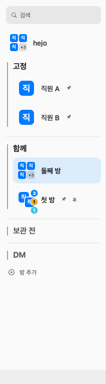
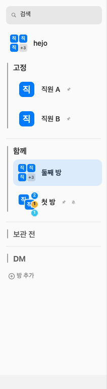
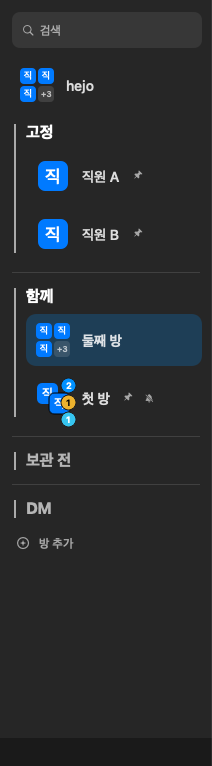
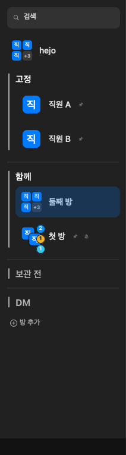
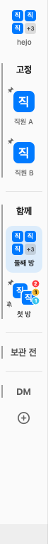
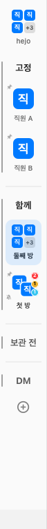
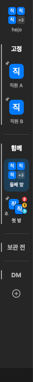
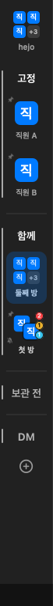

# TASK-38 — 사이드바 보기·움직임

필요 증거 수준 2. 원본 분리 실행과 hejo의 실제 AppKit 조립 비교다. 운영 ddots/hejo 앱 전체 비교나 픽셀 동일 비교가 아니다. 두 쪽은 같은 가짜 명부·방·배치·선택·수·핀·알림 상태를 쓴다. hejo는 실제 가짜 루프백과 짝맺은 뒤 canSend가 참인 상태다. 운영 서버에는 연결하지 않는다.

## 같은 상태 화면

| 모양 | ddots 원본 함수 | hejo AppKit |
|---|---|---|
| 밝음·목록 |  |  |
| 어두움·목록 |  |  |
| 밝음·탭 |  |  |
| 어두움·탭 |  |  |

8개 최종 PNG를 직접 표시해 확인했다. 글꼴 획과 기본 강조색의 최종 합성 농도에는 네이티브 렌더러 차이가 남으며, 정적 배치·표식·얼굴 묶음과 명시된 원문 수치를 비교했다.

보기 범위는 로고 아래 사이드바 766pt다(너비 212/68pt). 구획 이름·접힌 DM·얼굴 묶음·배지 3색·핀·종·선택 상자·연속 레일·방 추가·맨 아래 띠를 비교한다. 기본 DM 이름은 사장 선택대로 유지한다. 사진 없는 고정 홈은 그 방의 얼굴을 쓰며 기본 홈 사진을 빌리지 않는다.

원본 자료: SlackPanel의 slackTab/Row/Folded/SectionSignals/RoomCounters/Faces/SearchField 그리기 함수를 그대로 분리했다. 명부·동작 호출자는 가짜이며 원본 앱은 실행하지 않았다. 화면 밖 SwiftUI 렌더러가 직접 그리지 못하는 검색 입력칸만 같은 글자·위치의 정적 Text로 대체했다. 스크롤의 현재 보이는 내용은 같은 높이로 잘린 VStack에 둔다. 얼굴 이미지는 같은 ProfileAvatar 가짜 그림이다. hejo는 제품 ConversationView의 실제 표·셀·층을 캡처한다. 투명 배경과 원본 입력칸이 빠진 초기 PNG는 수락 근거에서 제외한다.

## 움직임·입력 증거

AT-89는 실제 NSTableRowView의 presentation 층을 중간 시각에 읽는다. 삽입된 행은 최종 y에 고정되고 opacity만 바뀌며, 아래 행의 y와 구획 레일 높이는 시작/끝 사이여야 한다. 전환 중 반전·화면에 보이는 위치의 클릭 대상·안정된 셀 유지·선택 상자 두 곳의 opacity spring·동작 줄이기 즉시 배치도 검사한다. 정적 PNG로 움직임 통과를 대신하지 않는다.

검색은 한 구절 전체·생각 중 줄·말한 이/방 분리·원본 강조색·한 줄/두 줄 높이를 검사한다. 메뉴 순서/구분선·접힌 구획 사진/얼굴 없음·고정 홈의 숨김/알림 해제·중복 방 제외·사진 자원 구분·이름 입력 포커스와 빈 이름 재질문을 제품 경로에서 검사한다.

검증 로그와 지문은 로컬 `.build/task38/`에 보관한다. 최종 결과·도달 수준은 impl-report의 TASK-38 결과를 따른다. 물리 입력기·실제 서버·두 Mac·운영 창 전체 결합은 운영 수락에 남는다.
