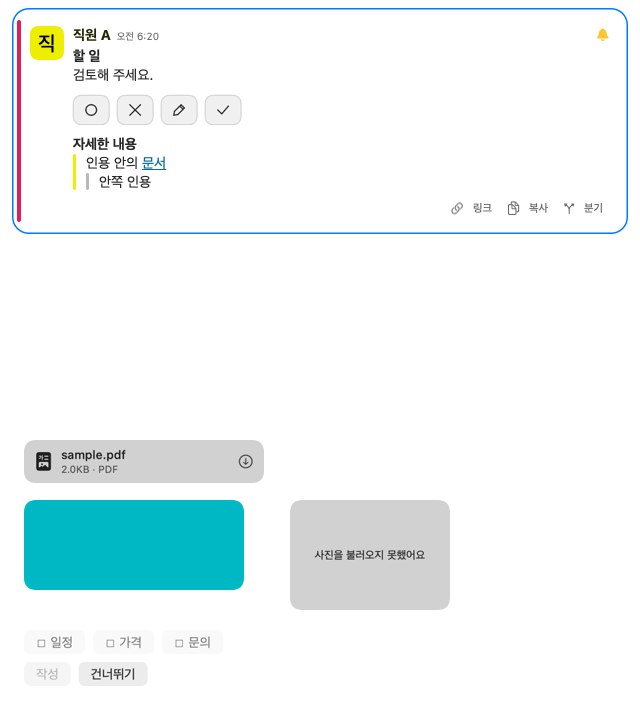
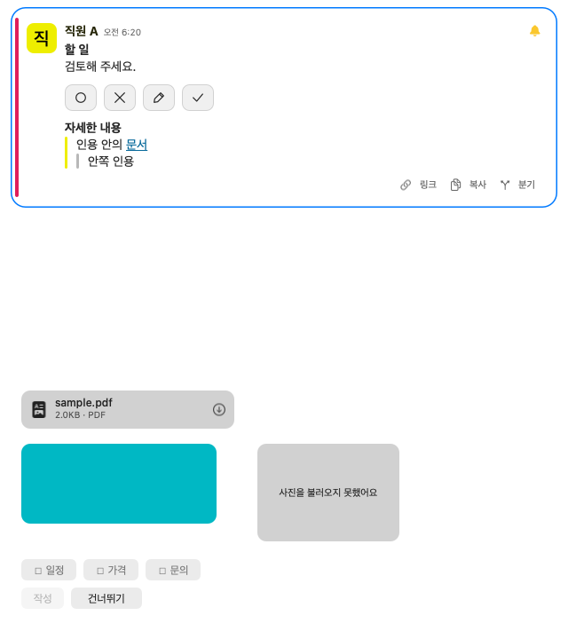
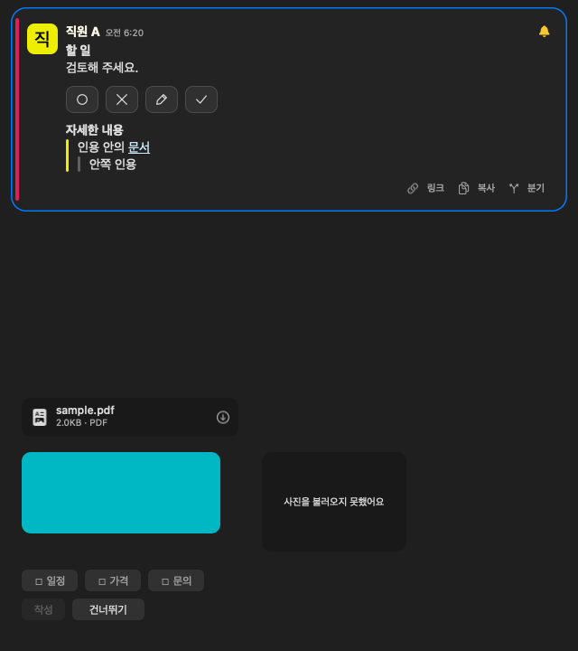
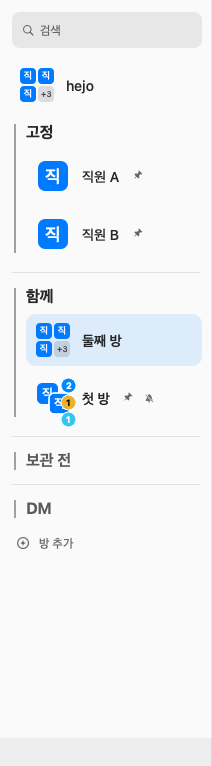
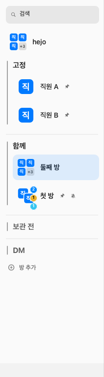
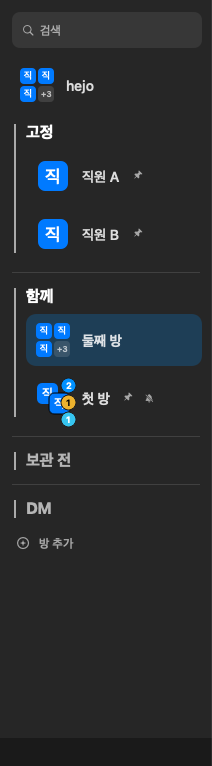
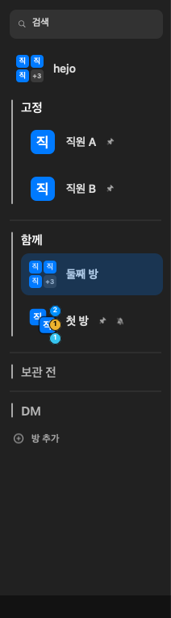

# TASK-39 카드·글·파일 비교

필요/도달 인계 증거 수준은 2/2다. 운영 앱 전체 비교·픽셀 동일 판정은 아니다. 실제 서버·두 Mac·물리 입력기·VoiceOver 실사용은 운영 수락에 남는다.

hejo는 가짜 루프백 문에 실제로 연결하고 같은 합성 기록을 기존 Controller·ConversationView의 카드 조립과 AppKit 보기로 그렸다. 원본은 ddots NativeThreadCard·SlackLayout·ReplyActionIcon과 slackApproval·fileView·HermesReplyChecklist를 분리 실행했다. 명부·콜백만 가짜이며 운영 홈을 쓰거나 메시지를 외부에 보내지 않는다. 일부 공통 native 서식·팔레트 계산은 공유하고, 각각의 카드 엔진과 단추/파일 보기는 원본과 제품을 따로 실행한다.

원본 SwiftUI 가로 ScrollView는 ImageRenderer에서 빈 그림이 나와 같은 320pt의 왼쪽 정렬 정적 틀로 대체했다. SwiftUI 조각은 ImageRenderer 결과를 NSImageView로 옮겨 native 캔버스에 찍었다. 실제 스크롤·누름 차단·선택/전송은 제품 시험으로 검사한다. 아래 그림의 체크리스트 베젤은 각 프레임워크 기본 제어이므로 미세한 농도·글자 기준선 차이가 있다.

| 상태 | ddots 원본 조각 | hejo 실제 보기 조립 |
|---|---|---|
| 연결됨·라이트 |  |  |
| 연결됨·다크 |  |  |
| 사이드바 핀·알림 끔·방 추가, 라이트 |  |  |
| 사이드바 핀·알림 끔·방 추가, 다크 |  |  |

카드에는 같은 요청·글 머리→36×30 단추→세부 본문·바깥/안쪽 인용·접근성 이름만 있는 아래 단추·연결된 답글 대상 외곽선·알림 종이 있다. 원본 카드 측정은 높이 226pt다. 파일 조각은 같은 2.0KB PDF(240×43), 440×180 사진을 220×90으로 표시한 것, 160×110 실패 자리다. 제품의 실제 404 경로도 실패 표시로 관찰했다. 삭제된 첨부 문구는 보완 54에 따라 생산하지 않는다.

사이드바는 같은 명부/방/읽음 상태를 쓰며 원본 검색칸의 static 대체와 글꼴 합성 차이는 TASK-38과 같다. N38-01 그림은 font 8의 intrinsic 11×12·9×11, 방 추가는 medium 15×15 그림 뒤 간격 8pt다.

전체·반복 시험, 돌연변이, 엄격 서명 검사, 그림 유효성 및 최종 파일 대조의 실제 결과는 같은 커밋의 impl-report와 로컬 `.build/task39/` 로그를 따른다. 중간 실패·수정 전 PNG는 최종 근거와 구분한다.
