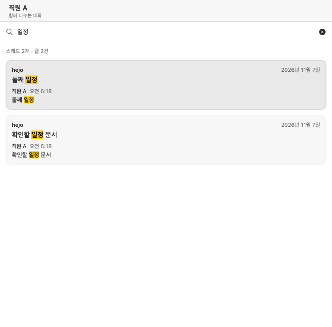
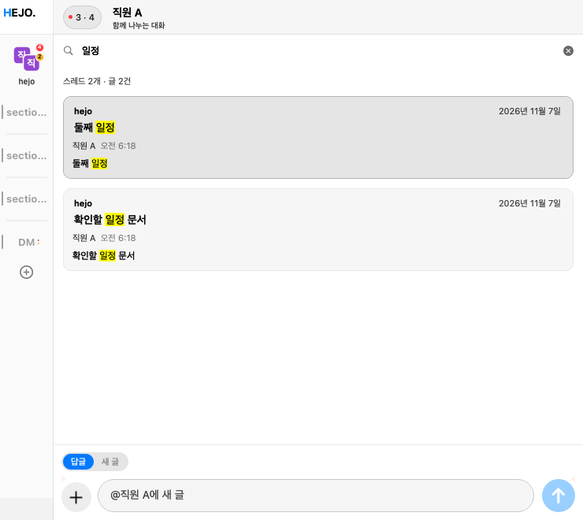
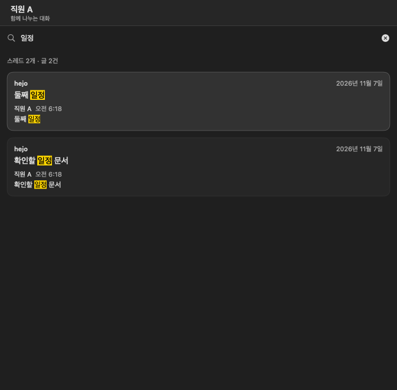
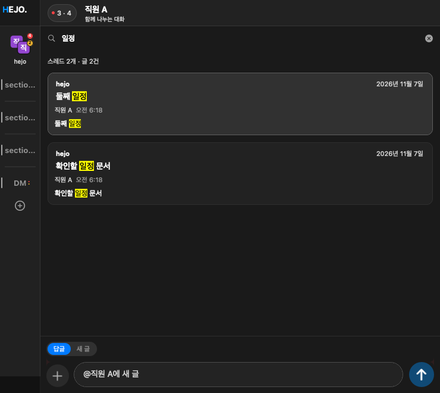
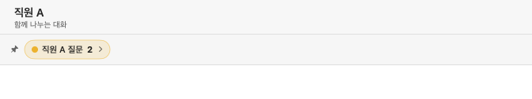
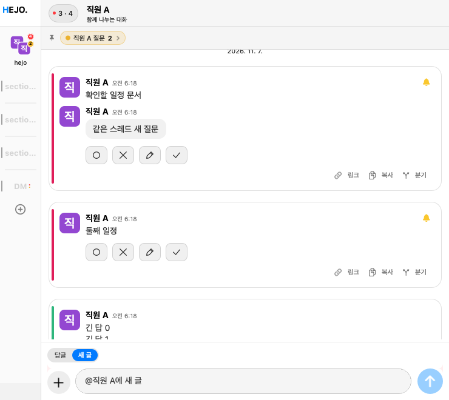
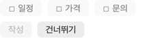
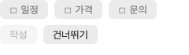
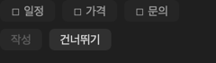
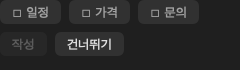

# TASK-40 스크롤·작업 공간 비교

필요/도달 인계 증거 수준은 2/2다. 원본·운영 앱 전체 또는 픽셀 동일 판정은 아니다. 실제 서버·두 Mac·손 트랙패드·물리 입력기·VoiceOver 실사용은 운영 수락에 남는다.

hejo는 임시 홈·가짜 루프백 문에 실제 연결한 최종 빌드의 Controller·ConversationView·NativeThreadList를 사용한다. 원본은 ChatWorkspace.workspaceHeader·slackNoticeBar·SlackFindView의 원문 함수를 같은 합성 글·명부·검색·요청 상태로 분리 실행했다. 원본 파일을 수정하지 않았다. ImageRenderer가 ScrollView·TextField를 그리지 못해 비교용 사본에서 스크롤 내용은 같은 정적 틀, 입력칸은 같은 글자로 대체했다. 문자열 검색/강조 계산 일부는 native helper를 공유한다. 실제 누름·키·휠·viewport 움직임은 제품에서 별도 검사한다.

원본 그림은 오른쪽 작업 공간만 있고 hejo 왼쪽 68pt 목록·아일랜드·작성기는 비교 대상에서 제외한다. 라이트/다크의 검색 줄·강조·말한 이·노트·결과 상자를 비교했다. AppKit 제어와 SwiftUI의 글자 기준선·결과 상자 높이는 약 6pt 차이가 있으며 픽셀 동일로 주장하지 않는다. 헤더 오른쪽 단추 제거와 도움말은 제품 시험에서도 관찰한다.

| 상태 | 원본 조각 | hejo 연결된 실제 보기 |
|---|---|---|
| 검색·라이트 |  |  |
| 검색·다크 |  |  |
| 같은 스레드당 요청 수 2 |  |  |
| N39-01 체크리스트·라이트 |  |  |
| N39-01 체크리스트·다크 |  |  |

체크리스트 원본은 TASK-39 때 읽은 HermesReplyChecklist를 분리 실행한 불변 비교기를 재사용했다. 제품은 이번 최종 빌드로 다시 조립했다. 그림은 원래 캔버스의 같은 240×70 영역이다. 원본 bordered의 실제 단추는 항목 61×24·작성 47×24·건너뛰기 69×24이고 native 실측도 같다. 선언된 12pt 환경과 실제 macOS 기본 제어 글꼴의 차이는 copy-review에 기록했다.

## 스크롤 표본

원문 NativeThreadList.performScroll의 가운데/끝 계산을 그대로 분리 실행하고 같은 native 행 사각형·300pt 뷰포트를 주었다. glideStep도 원문을 native NSScrollView에서 분리 실행했다. 재귀 예약만 단일 표본 실행으로 바꾸고 시계를 주입했다. 전체 원본 앱의 스크롤 실행은 아니다.

| 표본 | 원본 분리 계산/실행 | hejo 실제 native clip |
|---|---:|---:|
| 가운데 y | 1035.000 | 1035.000 |
| 끝 viewport.maxY | 1264.000 | 1264.000 |
| 성장 400pt·1프레임 이동 | 36.000 | 36.000 |
| 성장 50pt·20% 이동 | 10.000 | 10.000 |

100pt에서는 따라가고 150pt에서는 바닥 거리를 유지한다. 첫 36pt·다음 프레임·0.24 중간 위치·최종 1.2초 대기·기존 글 추가·크기 변경 행/오프셋·입력 취소는 AT-91에서 관찰했다. 알림 opacity·모드 색·칩 이동·창 높이 τ0.065의 중간 값도 단언했다. Space/방향/Home/End/Page 키 9종·클릭·휠은 별도 실제 AppKit 이벤트 진입 시험으로 확인했다. 휠의 자체 10pt 이동은 유지하면서 예약된 먼 이동을 취소했다.

최종 원시 표본·원본 대조는 로컬 `.build/task40/scroll-comparison.json`, 전체/반복·돌연변이·그림 검사는 `frozen-progress.json`·`mutation.json`·`post-checks.json`에 있다. 이전 실패·테마 수정 전 캡처는 최종 근거가 아니다. 운영 자료·배포·공용 릴리스·public·원격은 변경하지 않았다.
