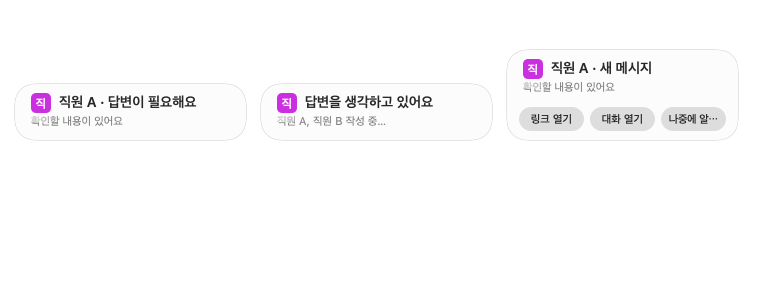
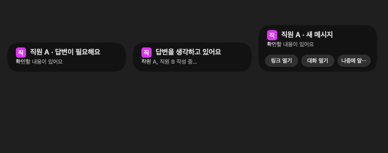

# TASK-41 펫·말풍선·창 증거

필요/도달 수준 2/2. 원본의 관련 함수 분리 실행과 실제 AppKit 보기 조립을 동일 합성 상태에서 비교했다. 운영 앱 전체·실제 서버·두 Mac·픽셀 동일 비교가 아니다. 실물 입력기·VoiceOver 실사용·다중 화면 실제 끌기는 운영 수락에 남는다.

## 같은 상태 화면

왼쪽부터 승인·작성 중·새 답이다. 원본 `PetView.swift`의 BubbleTextView·원본 ProfileAvatar 그리기와 PetLayout·PetAnimation·WritingShimmer를 별도로 컴파일했다. 제외 기능의 키·명부는 가짜 보조이고, 유리 생성/덮개는 원본 init의 native 구성을 같은 정적 캔버스에 조립했다. 원본 전체 앱의 네트워크/창 관리는 실행하지 않았다. 제품 그림은 최종 고정 입력의 제품 Sources를 별도 조립한 FoldedBubbleView다. 최종 앱 시험 바이너리의 원시 캡처는 NSButton의 동적 색 재그리기가 외관 범위 밖에서 일어나 비교에서 제외했다. 보완 조립은 bitmap cache까지 current drawing appearance 안에서 실행하며 제품 소스는 바꾸지 않는다.

| 상태 | ddots 원본 조각 | hejo 실제 native 보기 |
|---|---|---|
| 라이트 |  |  |
| 다크 |  |  |

단추 바탕 라이트/다크 표본의 원본·제품 최대 성분 차이는 0이었다(`.build/task41/capsule-colors.json`). 보완 조립의 명령·결과는 `native_capture.py`·`native-capture.json`에 있다.

유리 20pt·덮개 0.35, 얼굴 20/간격 8, 머리글 labelColor·14, 부제 11, 단추 0.12/둥근 12·줄임을 비교한다. 승인·작성 중은 단추가 없고 새 답에만 3개가 있다. 네이티브 제어를 투명 배경에 캐시하므로 배경 합성과 글자 기준선은 운영 화면과 동일하다고 주장하지 않는다. 실패 말풍선과 평소 사용량 대체 문구는 없다.

## 움직임 표본

원본 PetBubbleMotion·ChatWidthSlide·PetLayout/PetAnimation을 독립 실행했다. 제품은 실제 PetController의 반전/폭 상태와 native 입력을 검사했다. 아래 추종은 같은 위치·시각을 준 원본/제품 함수 표본이다.

| 표본 | ddots | hejo |
|---|---:|---:|
| 16ms 추종 x (τ0.065) | 118.480654 | 118.480654 |
| 16ms 여닫기 추종 x (τ0.105) | 80.973379 | 80.973379 |
| 지니 0.6에서 반전, 절반 뒤 | 0.800000 | 0.800000 |
| 폭 428→788, 0.15초 | 608.000000 | 608.000000 |
| 폭 덮개 끝 페이드 초 | 0.06 | 0.06 |

0.18 페이드의 실제 중간 opacity·종료 숨김, 3초 표면/12초 내용, 승인 유지·hoverArmed, 숨김 중 알림 없음, 열림 중 졸지 않음·Zzz, 홈 행동, 키보드/입력기·첫 클릭/더블클릭·머리줄 화면 이동과 높이 보류·가장자리 초기화·menu bar 층을 AT-92가 검사한다. N40-01은 AT-91·AT-78에서 실제 systemYellow 속성을 확인한다.

최종 원시 결과는 로컬 `.build/task41/frozen-progress.json`, `motion-comparison.json`, `mutation.json`, `post-checks.json`이다. 이전 실패한 구색 단정/일반 재배치 가드 전 검사는 `intermediate-before-color-guard`·`intermediate-before-bubble-show`·`intermediate-before-pop-clock`이며 최종 근거에서 제외한다. 운영·배포·public·원격 변경 없음.
